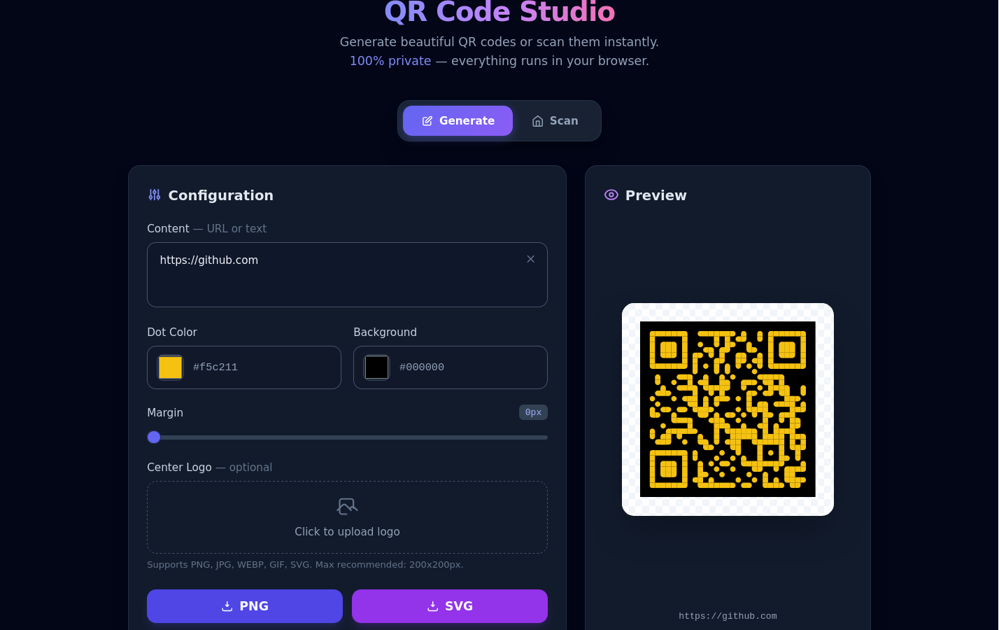

# QR Code Studio — Privacy-First Generator & Scanner

 

A privacy-first QR code generator and scanner. Everything runs in your browser — no server, no tracking.

**Live Demo:** [zero.ma/qr-code-studio/](https://zero.ma/qr-code-studio/)

---

## Features

### Generator
- Custom QR codes with colors and styles
- Download as PNG
- Adjustable size and error correction

### Scanner
- Scan via camera
- Scan via image upload
- Drag & drop support

### Privacy
- 100% client-side
- No server calls
- No tracking
- No data collection

---

## Tech Stack

- HTML5
- CSS3 (dark UI, custom properties)
- Vanilla JavaScript
- QR generation and scanning libraries
- Browser Camera API

No frameworks. No build tools. Single file.

---

## Live Demo

[zero.ma/qr-code-studio/](https://zero.ma/qr-code-studio/)

---

## Usage

1. Open `index.html` in any modern browser
2. Or visit the live demo
3. Generate or scan QR codes

---

## Notes

Built as a design experiment with AI assistance (DeepSeek).
Not a commercial product — just a useful tool.

---

## author
> by anas ait baani - @0x9z

## License

MIT — free to use for learning and personal projects.
